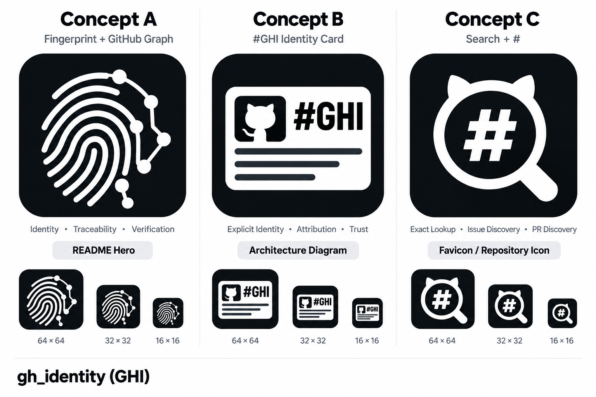
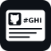

# GHI visual identity

Three complementary concepts are assigned by purpose. These are provisional
placements; none is designated as the sole official logo.



| Concept | Primary placement | Meaning | Editable source |
| --- | --- | --- | --- |
| A: Fingerprint + GitHub Graph | [README hero](../assets/branding/readme-hero.svg) | Identity, traceability, verification | [Concept A SVG](../assets/branding/concept-a.svg) |
| B: #GHI Identity Card | [README architecture diagram](../assets/branding/architecture.svg) and identity cards | Explicit identity | [Concept B SVG](../assets/branding/concept-b.svg) |
| C: Search + # | README heading and reusable favicon / repository artwork | Exact lookup, issue discovery, PR discovery | [Concept C SVG](../assets/branding/concept-c.svg) |

## Actual-size favicon previews

These PNGs have the labelled intrinsic pixel dimensions and are displayed without
enlargement. A and B retain their full detail to expose small-size limitations;
C is the compact default. Its 16px PNG uses a pixel-aligned variant with wider
openings in the hash; the 32/64px PNGs retain the full-size master.

| Concept | 64 × 64 | 32 × 32 | 16 × 16 |
| --- | --- | --- | --- |
| A |  |  |  |
| B |  |  |  |
| C |  |  |  |

## Reuse

- Use the SVG masters for README illustrations, diagrams and scaled output.
- Use [repository-icon.png](../assets/branding/repository-icon.png) for a 512 × 512 raster icon.
- Use [favicon.ico](../assets/branding/favicon.ico) for an ICO containing the exact 16, 32 and 64px C PNGs, without additional resampling.
- Use [concept-c.svg](../assets/branding/concept-c.svg) for a scalable SVG icon, or [concept-c-16.svg](../assets/branding/concept-c-16.svg) for a pixel-aligned 16px favicon.
- Keep the `#0d1117` rounded square and white marks. SVG lettering is outlined,
  with accessible titles and descriptions, so it needs no installed font.

GitHub has no independent repository avatar setting. The C artwork is therefore
used in the README heading and supplied for downstream favicon/icon use; adding
these files does not configure a browser favicon on github.com or a GitHub Pages
site. There is no Pages site in this change.

The comparison board was generated with the built-in image-generation tool from
the supplied three-concept reference. The production SVGs are editable vector
interpretations of those concepts. PNGs were exported from the SVGs with
Inkscape; the ICO packages the C sizes. The board is a presentation reference;
use the production assets for actual placement. No image-generation service or
graphics package is needed to run GHI.

To regenerate a PNG after editing a master, for example:

```bash
inkscape assets/branding/concept-c.svg \
  --export-filename=assets/branding/concept-c-32.png \
  --export-width=32 --export-height=32
```

For the small-size variant, export `concept-c-16.svg` at 16 × 16. Rebuild the ICO
from the three exported PNGs so its frames preserve their exact pixels:

```python
from PIL import Image

root = "assets/branding/"
Image.open(root + "concept-c-64.png").convert("RGBA").save(
    root + "favicon.ico", format="ICO", sizes=[(16, 16), (32, 32), (64, 64)],
    append_images=[Image.open(root + f"concept-c-{size}.png").convert("RGBA")
                   for size in (16, 32)],
)
```

Pillow is optional asset-authoring tooling, not a GHI runtime dependency.
